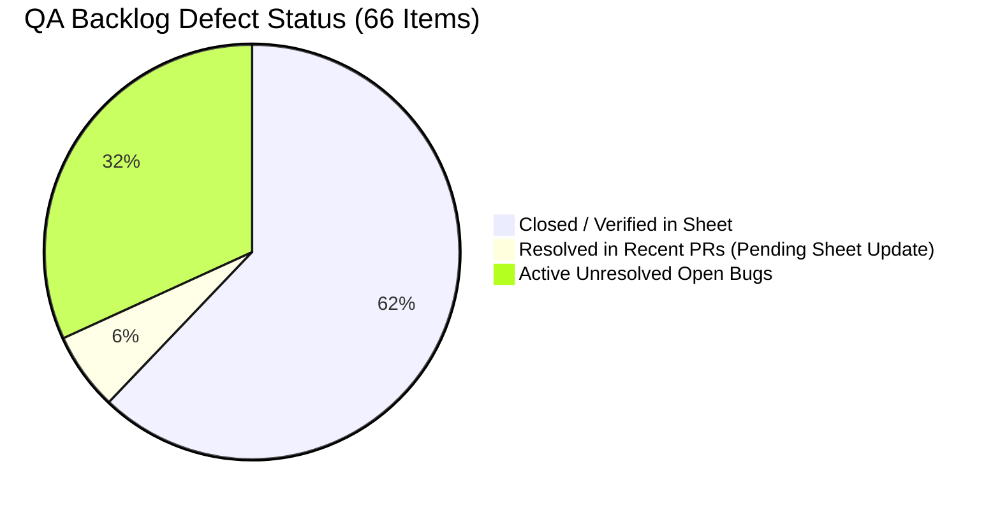

# Surakshak Open Backlog Defects Audit & Technical Reference

> **Document Status**: Active Technical Audit  
> **Source**: [Surakshak QA Bug Tracker](https://docs.google.com/spreadsheets/d/1DAYAJK-KK22fWfXK2LfBEcBbqDOTkZkJSkLukl5f5vE/) & Git Repository State  
> **Last Updated**: October 19, 2026

---

## 1. Executive Summary

A comprehensive cross-audit between the QA Spreadsheet (`BUG-001` through `BUG-067`), closed GitHub issues (`#81`–`#102`, `#109`–`#118`), and recently merged PRs (`#70`–`#76`, `#103`–`#108`, `#119`–`#121`) establishes the following current state:

- **Total Logged Defects in QA Sheet**: 66 (`BUG-001` – `BUG-067`)
- **Verified / Fixed / Won't Fix in Sheet**: 41 items
- **Open / In Progress / In Review in Sheet**: 25 items
- **Fixed by Recent PRs (Ready to mark 'Fixed' in sheet)**: **4 items** (`BUG-049`, `BUG-051`, `BUG-053`, `BUG-057`)
- **Truly Unresolved Active Backlog**: **21 items**

---

## 2. Active Unresolved Bugs Matrix (21 Items)

| Bug ID      | Title                                                          | Feature Area       | Severity | Priority | Status      | Primary Code Files                                                                                                                                        |
| :---------- | :------------------------------------------------------------- | :----------------- | :------- | :------- | :---------- | :-------------------------------------------------------------------------------------------------------------------------------------------------------- |
| **BUG-025** | No option to view uploaded photos in report history            | Incident Report    | Medium   | P2       | In Review   | [`app/incident-report.tsx`](file:///home/misaka10032/surakshak/app/app/incident-report.tsx)                                                               |
| **BUG-029** | Safe Journey overdue alert not sent when timer expires         | Safe Journey       | Critical | P1       | Open        | [`app/safe-journey.tsx`](file:///home/misaka10032/surakshak/app/app/safe-journey.tsx), Cloud Function                                                     |
| **BUG-030** | "I'm Safe" resets timer without updating arrival time          | Safe Journey       | High     | P1       | Open        | [`app/safe-journey.tsx`](file:///home/misaka10032/surakshak/app/app/safe-journey.tsx)                                                                     |
| **BUG-040** | Suspicious Follow triggers when stationary; fails in motion    | Advanced Safety    | High     | P1       | In Progress | [`src/hooks/useSuspiciousFollow.ts`](file:///home/misaka10032/surakshak/app/src/hooks/useSuspiciousFollow.ts)                                             |
| **BUG-041** | 3 unauthenticated reports permanently censor community post    | Community Feed     | High     | P1       | In Progress | [`src/services/firebase/community.service.ts`](file:///home/misaka10032/surakshak/app/src/services/firebase/community.service.ts)                         |
| **BUG-043** | Live Location expiry timer halts in background (battery drain) | Live Location      | High     | P1       | In Progress | [`src/hooks/useLiveLocation.ts`](file:///home/misaka10032/surakshak/app/src/hooks/useLiveLocation.ts)                                                     |
| **BUG-044** | Low-battery alert sends SMS even when phone is charging        | Battery Alert      | Medium   | P2       | Open        | [`src/hooks/useBatteryAlert.ts`](file:///home/misaka10032/surakshak/app/src/hooks/useBatteryAlert.ts)                                                     |
| **BUG-045** | Safety Map queries nationwide collection without bounding box  | Safety Map         | High     | P1       | Open        | [`src/services/firebase/unsafe-areas.service.ts`](file:///home/misaka10032/surakshak/app/src/services/firebase/unsafe-areas.service.ts)                   |
| **BUG-054** | Safe Journey starts without a valid destination                | Safe Journey       | Medium   | P2       | Open        | [`app/safe-journey.tsx`](file:///home/misaka10032/surakshak/app/app/safe-journey.tsx)                                                                     |
| **BUG-055** | Location features hang indefinitely on weak network            | Core Location      | High     | P1       | Open        | [`src/services/location.service.ts`](file:///home/misaka10032/surakshak/app/src/services/location.service.ts)                                             |
| **BUG-056** | SMS remains trapped as draft when SMS permission denied        | Core SOS / SMS     | High     | P1       | Open        | [`src/services/sms.service.ts`](file:///home/misaka10032/surakshak/app/src/services/sms.service.ts)                                                       |
| **BUG-058** | Drafted SOS message not auto-sent after permission grant       | Core SOS / SMS     | High     | P1       | Open        | [`src/services/sms.service.ts`](file:///home/misaka10032/surakshak/app/src/services/sms.service.ts)                                                       |
| **BUG-059** | Emergency contacts not notified when ETA is extended           | Safe Journey       | High     | P1       | Open        | [`app/safe-journey.tsx`](file:///home/misaka10032/surakshak/app/app/safe-journey.tsx)                                                                     |
| **BUG-060** | App accepts dummy phone numbers (e.g. 9999999999)              | Emergency Contacts | High     | P1       | Open        | [`src/utils/phone.utils.ts`](file:///home/misaka10032/surakshak/app/src/utils/phone.utils.ts)                                                             |
| **BUG-061** | Siren volume depends on media volume instead of alarm stream   | Siren Alarm        | High     | P1       | Open        | [`src/hooks/useSiren.ts`](file:///home/misaka10032/surakshak/app/src/hooks/useSiren.ts)                                                                   |
| **BUG-062** | Emergency helpline tiles only type number into dialer          | Home Emergency     | Medium   | P2       | Open        | [`src/utils/phone.utils.ts`](file:///home/misaka10032/surakshak/app/src/utils/phone.utils.ts)                                                             |
| **BUG-063** | Clipboard paste allows alphabets/emojis into phone field       | Emergency Contacts | Low      | P3       | Open        | [`src/components/features/emergency/ContactFormModal.tsx`](file:///home/misaka10032/surakshak/app/src/components/features/emergency/ContactFormModal.tsx) |
| **BUG-064** | Safety Map defaults to Mumbai instead of current user GPS      | Safety Map         | Medium   | P2       | Open        | [`app/(tabs)/map.tsx`](<file:///home/misaka10032/surakshak/app/app/(tabs)/map.tsx>)                                                                       |
| **BUG-065** | Unsafe area markers temporarily vanish on background/resume    | Safety Map         | Low      | P3       | Open        | [`app/(tabs)/map.tsx`](<file:///home/misaka10032/surakshak/app/app/(tabs)/map.tsx>)                                                                       |
| **BUG-066** | Incident report selected photos not visible in dark/light mode | Incident Report    | Medium   | P2       | Open        | [`app/incident-report.tsx`](file:///home/misaka10032/surakshak/app/app/incident-report.tsx)                                                               |
| **BUG-067** | Incident report photo picker only permits 1 photo at a time    | Incident Report    | Low      | P3       | Open        | [`app/incident-report.tsx`](file:///home/misaka10032/surakshak/app/app/incident-report.tsx)                                                               |

---

## 3. Detailed Defect Specifications

### Category A: Safe Journey & Session Watchdogs

#### [BUG-029] Safe Journey overdue alert is not automatically sent when timer expires

- **Area**: Safe Journey
- **Severity**: Critical | **Priority**: P1 | **Status**: Open
- **Reported By**: Pranav (26-09-2026)
- **Steps to Reproduce**:
  1. Open Safe Journey, select destination, contact, and ETA.
  2. Start the Safe Journey.
  3. Lock the phone and leave the app in the background / killed until ETA passes.
  4. Observe whether the emergency contact receives an overdue distress alert.
  5. Reopen Surakshak.
- **Expected Behavior**: When the timer expires without check-in or arrival, an overdue alert must dispatch automatically without requiring the user to wake the phone or reopen the app.
- **Actual Behavior**: The overdue SMS is only dispatched when Surakshak is foregrounded and the user re-navigates to Safe Journey. If the user is incapacitated or phone battery dies, no alert is ever sent.
- **Root Cause**: Client-side timers (`setTimeout` / `setInterval`) in [`app/safe-journey.tsx`](file:///home/misaka10032/surakshak/app/app/safe-journey.tsx) are halted by OS battery savers when the app is suspended.
- **Remediation**: Deploy a server-side Cloud Function (`checkOverdueJourneys`) triggered via Cloud Scheduler every minute that queries Firestore for `status == 'active'` and `expectedArrivalAt < now()`, dispatching SMS alerts via Twilio/Fast2SMS.

---

#### [BUG-030] “I’m Safe” resets Safe Journey timer without updating expected arrival time

- **Area**: Safe Journey
- **Severity**: High | **Priority**: P1 | **Status**: Open
- **Reported By**: Pranav (26-09-2026)
- **Steps to Reproduce**:
  1. Start a Safe Journey with a 30-minute ETA.
  2. Let the countdown tick down to 10 minutes remaining.
  3. Tap "I'm Safe" (check-in).
  4. Inspect the countdown and displayed ETA time.
- **Expected Behavior**: Tapping "I'm Safe" should either mark the journey as safely completed, or if intended as a check-in interval, synchronize the displayed expected arrival time and notify contacts.
- **Actual Behavior**: Countdown resets to the initial duration, but the displayed expected arrival time remains unchanged, creating a conflicting state. No confirmation or SMS is sent.
- **Root Cause**: [`app/safe-journey.tsx`](file:///home/misaka10032/surakshak/app/app/safe-journey.tsx) calls `checkInSafeJourney()` which updates `lastCheckInAt`, but fails to push a revised `expectedArrivalAt` to Firestore or reset the local ETA target.
- **Remediation**: Clarify UX: split into explicit "I Have Arrived" (terminates session) vs "Periodic Check-In" (advances deadline and pushes synchronized timestamp).

---

#### [BUG-054] Safe Journey starts without a valid destination

- **Area**: Safe Journey / Form Validation
- **Severity**: Medium | **Priority**: P2 | **Status**: Open
- **Reported By**: Suhani (15-10-2026)
- **Steps to Reproduce**:
  1. Open Safe Journey.
  2. In the destination field, type two arbitrary characters (e.g. `aa`).
  3. Tap "Start Journey".
- **Expected Behavior**: Destination must be validated against Google Places Autocomplete or require minimum valid address formatting with geocoordinates before dispatching start SMS.
- **Actual Behavior**: `schema` in [`app/safe-journey.tsx`](file:///home/misaka10032/surakshak/app/app/safe-journey.tsx#L52-L53) only enforces `z.string().trim().min(2)`, allowing nonsensical destination names to be broadcast to emergency contacts.
- **Root Cause**: Lacks mandatory geocoordinate binding (`destinationCoords === null` is ignored on submit).
- **Remediation**: Require `destinationCoords !== null` or increase string validation to enforce selected place candidates from `GooglePlacesAutocomplete`.

---

#### [BUG-059] Emergency contacts are not notified when the expected arrival time is extended

- **Area**: Safe Journey / SMS Dispatch
- **Severity**: High | **Priority**: P1 | **Status**: Open
- **Reported By**: Pranav (16-10-2026)
- **Steps to Reproduce**:
  1. Start Safe Journey with a 20-minute ETA (contacts receive initial departure SMS).
  2. Tap `+15 min` or `+30 min` to extend the ETA.
  3. Check the emergency contact's device.
- **Expected Behavior**: Emergency contacts should receive an SMS update informing them that the arrival time has been extended to avoid premature panic.
- **Actual Behavior**: Firestore `expectedArrivalAt` is incremented, but no follow-up SMS is dispatched to contacts.
- **Root Cause**: `handleExtend()` in [`app/safe-journey.tsx`](file:///home/misaka10032/surakshak/app/app/safe-journey.tsx#L316-L328) invokes `extendSafeJourneyEta()` but does not call `sendSMSAlert()` with an ETA update template.
- **Remediation**: Call `sendSafeJourneyExtensionSMS(contacts, newEtaTime)` inside `handleExtend()`.

---

### Category B: Location Tracking, Battery & Background Services

#### [BUG-040] Suspicious Follow detection falsely triggers when stationary and fails during motion

- **Area**: Advanced Safety / `useSuspiciousFollow`
- **Severity**: High | **Priority**: P1 | **Status**: In Progress
- **Reported By**: LostAion (14-10-2026)
- **Steps to Reproduce**:
  1. Enable Suspicious Follow detection in Settings.
  2. Walk 50 meters, then sit stationary in a cafe or at home for 10 minutes.
  3. Observe system notification tray.
- **Expected Behavior**: The app should not fire a false stalking alarm when the user is sitting still.
- **Actual Behavior**: Flawed algorithm in [`src/hooks/useSuspiciousFollow.ts`](file:///home/misaka10032/surakshak/app/src/hooks/useSuspiciousFollow.ts#L86-L96) checks if the _device's own snapshots_ remained within 200m for 10 minutes after a 50m movement, firing a terrifying false alarm: "⚠️ Suspicious Activity Detected: You may be being followed!". Conversely, during actual tracking along a route, it never fires.
- **Root Cause**: Single-device GPS cannot detect external followers without external beacon/BLE signals or secondary telemetry.
- **Remediation**: Either deprecate and disable `useSuspiciousFollow` from the UI or redesign into an opt-in Route Deviation / Stationary Check-In system.

---

#### [BUG-043] Live Location session expiry timer halts in background, causing runaway GPS polling and battery drain

- **Area**: Live Location / Background Lifecycle
- **Severity**: High | **Priority**: P1 | **Status**: In Progress
- **Reported By**: LostAion (14-10-2026)
- **Steps to Reproduce**:
  1. Start a 15-minute Live Location sharing session.
  2. Lock device and leave it in background for 2+ hours.
  3. Check battery drain and active notification tray.
- **Expected Behavior**: High-frequency background GPS tracking must unregister and stop immediately when the 15-minute mark is reached.
- **Actual Behavior**: While PR #73 fixed top-level task registration, `TaskManager.defineTask` in [`src/hooks/useLiveLocation.ts`](file:///home/misaka10032/surakshak/app/src/hooks/useLiveLocation.ts#L47-L63) never compares `Date.now()` with `session.expiresAt`. The native task polls GPS indefinitely until device battery dies.
- **Root Cause**: Expiry was managed only via a React `setTimeout` inside the unmounted UI component.
- **Remediation**: Persist `LIVE_LOCATION_EXPIRES_AT` in `AsyncStorage`. Inside `TaskManager.defineTask`, if `Date.now() > expiresAt`, call `Location.stopLocationUpdatesAsync()` and mark session ended.

---

#### [BUG-044] Emergency low-battery alert automatically sends panic SMS to family even when phone is charging

- **Area**: Battery Alert / `useBatteryAlert`
- **Severity**: Medium | **Priority**: P2 | **Status**: Open
- **Reported By**: LostAion (14-10-2026)
- **Steps to Reproduce**:
  1. Plug phone into charger at 15% battery.
  2. Open Surakshak or let background watcher run.
  3. Observe emergency SMS dispatch.
- **Expected Behavior**: Low-battery panic SMS must be suppressed if the phone is plugged in and actively charging (`BatteryState.CHARGING` or `BatteryState.FULL`).
- **Actual Behavior**: [`src/hooks/useBatteryAlert.ts`](file:///home/misaka10032/surakshak/app/src/hooks/useBatteryAlert.ts#L72-L77) checks only `batteryFraction <= 0.20`, blasting emergency distress SMS to family while the phone is safely charging on a desk.
- **Root Cause**: `maybeFire()` omits `await Battery.getBatteryStateAsync()`.
- **Remediation**: In [`src/hooks/useBatteryAlert.ts`](file:///home/misaka10032/surakshak/app/src/hooks/useBatteryAlert.ts), check `const state = await Battery.getBatteryStateAsync();` and return early if `state === Battery.BatteryState.CHARGING || state === Battery.BatteryState.FULL`.

---

#### [BUG-055] Location features hang indefinitely on weak network connections without fallback timeout

- **Area**: Location Core / Safe Journey / Incident Report
- **Severity**: High | **Priority**: P1 | **Status**: Open
- **Reported By**: Pranav (16-10-2026)
- **Steps to Reproduce**:
  1. Throttle cellular network to 2G/poor signal.
  2. Open Live Location, Safe Journey, Nearby Help, or Incident Report.
  3. Observe spinner screen.
- **Expected Behavior**: Screen should acquire best-effort cached fix or timeout within 5–8 seconds with an explicit error / retry affordance.
- **Actual Behavior**: Screens remain indefinitely stuck on the spinner; UI is unusable until network improves.
- **Root Cause**: `getCurrentLocation()` and `getFreshLocation()` in [`src/services/location.service.ts`](file:///home/misaka10032/surakshak/app/src/services/location.service.ts#L30-L46) invoke `Location.getCurrentPositionAsync()` without a `Promise.race` timeout wrapper.
- **Remediation**: Unify all location-fetching functions to route through `getLocationWithTimeout(8000)`.

---

### Category C: Emergency Contacts, Phone Inputs & Siren

#### [BUG-060] App accepts unverified emergency contact numbers based only on their format

- **Area**: Emergency Contacts
- **Severity**: High | **Priority**: P1 | **Status**: Open
- **Reported By**: Pranav (16-10-2026)
- **Steps to Reproduce**:
  1. Navigate to Emergency Contacts -> Add Contact.
  2. Enter name "Test" and dummy number `9999999999` or `8888888888`.
  3. Save contact.
- **Expected Behavior**: The app should validate or warn when non-routable dummy numbers are entered, or offer test ping SMS verification.
- **Actual Behavior**: `validateIndianPhone()` in [`src/utils/phone.utils.ts`](file:///home/misaka10032/surakshak/app/src/utils/phone.utils.ts) applies only regex `^[6-9]\d{9}$`, accepting repeated dummy digits without checks.
- **Root Cause**: No heuristic to detect repetitive/sequential patterns (e.g. `9999999999`, `9876543210`) or optional OTP verification.
- **Remediation**: Add regex heuristics blocking repeated digits and sequential dummy numbers, warning users to provide real emergency phone numbers.

---

#### [BUG-061] Siren volume depends on the device's media volume

- **Area**: Emergency Siren
- **Severity**: High | **Priority**: P1 | **Status**: Open
- **Reported By**: Pranav (16-10-2026)
- **Steps to Reproduce**:
  1. Set device media volume to 0 (silent/mute).
  2. Open Surakshak and activate the Siren.
  3. Observe volume level.
- **Expected Behavior**: Emergency siren should sound at maximum audible volume, utilizing the Alarm audio stream rather than media stream.
- **Actual Behavior**: Siren is muted or barely audible because standard audio playback binds to media volume.
- **Root Cause**: [`src/hooks/useSiren.ts`](file:///home/misaka10032/surakshak/app/src/hooks/useSiren.ts#L24) instantiates `createAudioPlayer()` which plays through `Audio.STREAM_MUSIC` by default.
- **Remediation**: Configure `Audio.setAudioModeAsync({ playsInSilentModeIOS: true, staysActiveInBackground: true })` and route audio through the Alarm/Ringtone stream via native audio mode attributes on Android.

---

#### [BUG-062] Using emergency numbers from the home tab results only in the number being typed into a selected call app

- **Area**: Home Emergency Dialers
- **Severity**: Medium | **Priority**: P2 | **Status**: Open
- **Reported By**: Anuj (16-10-2026)
- **Steps to Reproduce**:
  1. On Home dashboard, tap an emergency helpline card (e.g. 112 / 1091).
  2. Observe system response.
- **Expected Behavior**: Direct phone call should initiate immediately or open native phone dialer with 1-tap call confirmation.
- **Actual Behavior**: Number is pre-filled into dialer, requiring secondary tap by user.
- **Root Cause**: Handled via `Linking.openURL('tel:112')` in [`src/utils/phone.utils.ts`](file:///home/misaka10032/surakshak/app/src/utils/phone.utils.ts) which only launches the dialer intent. Direct calling without dialer requires `android.permission.CALL_PHONE`.
- **Remediation**: Clarify UX expectation in documentation: `tel:` intent is intentional on iOS and standard Android to avoid accidental emergency service dialing; for immediate calls, request `CALL_PHONE` native permission.

---

#### [BUG-063] When saving an emergency contact, clipboard paste allows non-numeric characters into phone input

- **Area**: Emergency Contacts / `ContactFormModal`
- **Severity**: Low | **Priority**: P3 | **Status**: Open
- **Reported By**: Anuj (16-10-2026)
- **Steps to Reproduce**:
  1. Copy text with emojis or letters to clipboard.
  2. Open Emergency Contacts -> Add Contact.
  3. Paste clipboard text into the phone number field.
- **Expected Behavior**: Input field should sanitize pasted input in real time, stripping non-digit characters.
- **Actual Behavior**: Field accepts alphabets and emojis while editing (only failing later upon validation submit).
- **Root Cause**: `keyboardType="phone-pad"` in [`src/components/features/emergency/ContactFormModal.tsx`](file:///home/misaka10032/surakshak/app/src/components/features/emergency/ContactFormModal.tsx#L112-L115) only controls the virtual keyboard; `onChangeText` forwards the raw pasted string directly to form state without stripping `[^\d+]`.
- **Remediation**: Sanitize in `onChangeText`: `onChange(text.replace(/[^\d+]/g, ''))`.

---

### Category D: Incident Reporting, Photos & Media

#### [BUG-025] / [BUG-066] No option to view uploaded photos in report history & selected photos not visible

- **Area**: Incident Report / History
- **Severity**: Medium | **Priority**: P2 | **Status**: Open / In Review
- **Reported By**: Anuj (18-09-2026) & Yash (17-10-2026)
- **Steps to Reproduce**:
  1. Submit an incident report with 2 attached images.
  2. Switch to the History tab.
  3. Tap report card and attempt to view full images.
- **Expected Behavior**: Uploaded photos should render clear thumbnails and open full-screen in [`ImageViewer`](file:///home/misaka10032/surakshak/app/src/components/features/community/ImageViewer.tsx) when tapped.
- **Actual Behavior**: History cards lack fallback handling for legacy reports where `photoUrls` was stored as `photos`, or image rendering fails due to missing container dimensions in dark mode.
- **Root Cause**: In [`app/incident-report.tsx`](file:///home/misaka10032/surakshak/app/app/incident-report.tsx#L427-L448), thumbnail rendering omits null checks for legacy documents and dark theme contrast borders.
- **Remediation**: Add normalization: `const urls = item.photoUrls ?? item.photos ?? [];` and wire full-screen modal viewer with zoom affordance.

---

#### [BUG-067] Incident report photo picker only permits 1 photo at a time instead of multi-select

- **Area**: Incident Report / Photo Picker
- **Severity**: Low | **Priority**: P3 | **Status**: Open
- **Reported By**: Yash (17-10-2026)
- **Steps to Reproduce**:
  1. Open Incident Report -> Add Photos.
  2. Attempt to select 3 photos in the device gallery simultaneously.
- **Expected Behavior**: Device gallery should allow multi-selection up to the allowed maximum (5 photos).
- **Actual Behavior**: Photo picker closes immediately after selecting a single photo, forcing the user to repeat the process 5 times.
- **Root Cause**: `ImagePicker.launchImageLibraryAsync()` in [`app/incident-report.tsx`](file:///home/misaka10032/surakshak/app/app/incident-report.tsx#L143-L146) omits `allowsMultipleSelection: true` and `selectionLimit: APP_CONFIG.INCIDENT_MAX_PHOTOS - photoUris.length`.
- **Remediation**: Pass `allowsMultipleSelection: true` and map `result.assets.map(a => a.uri)`.

---

### Category E: Safety Map & Geospatial Queries

#### [BUG-045] Safety Map downloads all unsafe areas nationwide without geospatial bounding box

- **Area**: Safety Map / Performance & Firestore Costs
- **Severity**: High | **Priority**: P1 | **Status**: Open
- **Reported By**: LostAion (14-10-2026)
- **Steps to Reproduce**:
  1. Open Safety Map in an active environment with hundreds of reports nationwide.
  2. Measure network throughput and frame rendering rate.
- **Expected Behavior**: Map should query only unsafe areas within a 50km radius / viewport bounding box.
- **Actual Behavior**: `subscribeToUnsafeAreas()` in [`src/services/firebase/unsafe-areas.service.ts`](file:///home/misaka10032/surakshak/app/src/services/firebase/unsafe-areas.service.ts#L76-L92) executes an unbounded query across the entire `unsafeAreas` collection nationwide.
- **Root Cause**: Query uses only `orderBy('createdAt', 'desc')` without geohash ranges or document limits.
- **Remediation**: Implement geohash bounding box queries (e.g. `geofire-common`) or add `limit(100)` centered on the current user position.

---

#### [BUG-064] Opening the maps initially hovers over a random area in Mumbai instead of current user GPS

- **Area**: Safety Map / Initial Viewport
- **Severity**: Medium | **Priority**: P2 | **Status**: Open
- **Reported By**: Anuj (16-10-2026)
- **Steps to Reproduce**:
  1. Ensure device location is turned ON.
  2. Open Safety Map tab.
  3. Observe initial camera position.
- **Expected Behavior**: Camera should center over user's current GPS coordinates.
- **Actual Behavior**: Map centers on Mumbai fallback coordinates (`19.0760, 72.8777`) because `currentLocation` is initially null during component mount.
- **Root Cause**: [`app/(tabs)/map.tsx`](<file:///home/misaka10032/surakshak/app/app/(tabs)/map.tsx#L98-L106>) initializes `initialRegion` with fallback coordinates, but lacks a `mapRef.current?.animateToRegion()` hook when `currentLocation` resolves.
- **Remediation**: Add an effect watching `currentLocation`: when first acquired, animate camera smoothly to user coordinates.

---

#### [BUG-065] Exiting the app and reopening it causes unsafe area markers to disappear temporarily

- **Area**: Safety Map / AppState Lifecycle
- **Severity**: Low | **Priority**: P3 | **Status**: Open
- **Reported By**: Anuj (16-10-2026)
- **Steps to Reproduce**:
  1. Open Safety Map and zoom out.
  2. Background app (e.g. switch to phone dialer) and reopen.
  3. Observe map pins.
- **Expected Behavior**: Markers should remain cached and immediately visible without blank flashes.
- **Actual Behavior**: Markers disappear briefly while Firestore listener reconnects.
- **Root Cause**: Markers are stored solely in transient React state without offline AsyncStorage persistence.
- **Remediation**: Cache markers in `useLocationStore` or AsyncStorage so they render instantly on resume while network sync proceeds.

---

### Category F: SMS Fallbacks & Messaging State

#### [BUG-056] / [BUG-058] SMS message remains as draft when permission denied & not sent after permission grant

- **Area**: Core SOS / SMS Dispatch
- **Severity**: High | **Priority**: P1 | **Status**: Open
- **Reported By**: Pranav (16-10-2026)
- **Steps to Reproduce**:
  1. Deny SMS permission when prompted.
  2. Trigger SOS or Safe Journey alert.
  3. Observe that SMS opens in native SMS app as a draft.
  4. Grant SMS permission in App Settings and return to app.
- **Expected Behavior**: Denying permission should prompt a clear in-app dialog; once permission is granted, pending emergency SMS should dispatch immediately.
- **Actual Behavior**: System delegates to `expo-sms` compose sheet leaving message as an unsent draft in the messaging app; granting permission later does not dispatch the pending message.
- **Root Cause**: [`src/services/sms.service.ts`](file:///home/misaka10032/surakshak/app/src/services/sms.service.ts#L86-L99) falls back to interactive compose UI without persisting an unsent outbound dispatch queue.
- **Remediation**: Maintain an offline `PENDING_SMS_DISPATCH` queue in `AsyncStorage`. Attach an `AppState` listener checking `checkSmsPermission()` to flush queued messages when returning from Settings.

---

### Category G: Community Content & Moderation

#### [BUG-041] Any user can permanently censor/hide community posts with 3 unauthenticated reports

- **Area**: Community Feed / Moderation
- **Severity**: High | **Priority**: P1 | **Status**: In Progress
- **Reported By**: LostAion (14-10-2026)
- **Steps to Reproduce**:
  1. Open Community feed.
  2. Select any post and tap "Report" 3 times in rapid succession.
- **Expected Behavior**: A user should only be allowed 1 report per post; reports must record `reporterId` and route to admin review rather than auto-hiding.
- **Actual Behavior**: [`reportPost()`](file:///home/misaka10032/surakshak/app/src/services/firebase/community.service.ts#L202-L215) takes no `userId`, blindly increments `reportCount`, and sets `isHidden: true` when count reaches 3.
- **Root Cause**: Missing subcollection tracking reporter UIDs and missing rate-limiting.
- **Remediation**: Require `userId` in `reportPost(postId, userId)`. Write to `communityPosts/{id}/reports/{userId}` using Firestore rules that enforce unique reporting, and flag for moderation without auto-censorship.

---

## 4. Backlog Items Resolved by Recent PRs (Ready for Sheet Update)

The following 4 spreadsheet defects were directly resolved by recently merged pull requests and should be updated from `Open` to `Fixed` in the Google Sheet:

| Bug ID      | Title                                               | Resolving PR & Issue         | Resolution Summary                                                                                                                                   |
| :---------- | :-------------------------------------------------- | :--------------------------- | :--------------------------------------------------------------------------------------------------------------------------------------------------- |
| **BUG-049** | Language Selection screen has no back button        | **PR #103** / **Issue #83**  | Added [`ScreenHeader`](file:///home/misaka10032/surakshak/app/src/components/ui/ScreenHeader.tsx) with back navigation in `app/language-select.tsx`. |
| **BUG-051** | Phone number digits invisible in dark mode          | **PR #108** / **PR #121**    | Fixed text color token bindings on phone input fields in dark theme.                                                                                 |
| **BUG-053** | No in-app recovery path when permission is denied   | **PR #121** / **Issue #115** | Implemented `Linking.openSettings()` with `AppState` auto-refresh on return.                                                                         |
| **BUG-057** | SOS shows message sent confirmation when SMS denied | **PR #120** / **Issue #112** | Added typed `SOSSendOutcome` differentiating permission denial from success.                                                                         |

---

## 5. Duplicate & Overlapping Defect Mappings

| Primary Defect        | Overlapping Bug ID   | Nature of Overlap                                                                                                                         |
| :-------------------- | :------------------- | :---------------------------------------------------------------------------------------------------------------------------------------- |
| **BUG-025**           | **BUG-066**          | Identical defect: Incident report photos invisible in history/detail view.                                                                |
| **BUG-030**           | **BUG-059**          | Shared lifecycle: "I'm Safe" / ETA extension fails to push SMS updates to contacts.                                                       |
| **BUG-056**           | **BUG-058**          | Two sides of SMS fallback: drafts stranded in messaging app without auto-send queue.                                                      |
| **BUG-042** _(Fixed)_ | **BUG-043** _(Open)_ | Distinct: PR #73 fixed module-scope registration crash (`BUG-042`), but background session expiry timer halting (`BUG-043`) remains open. |
